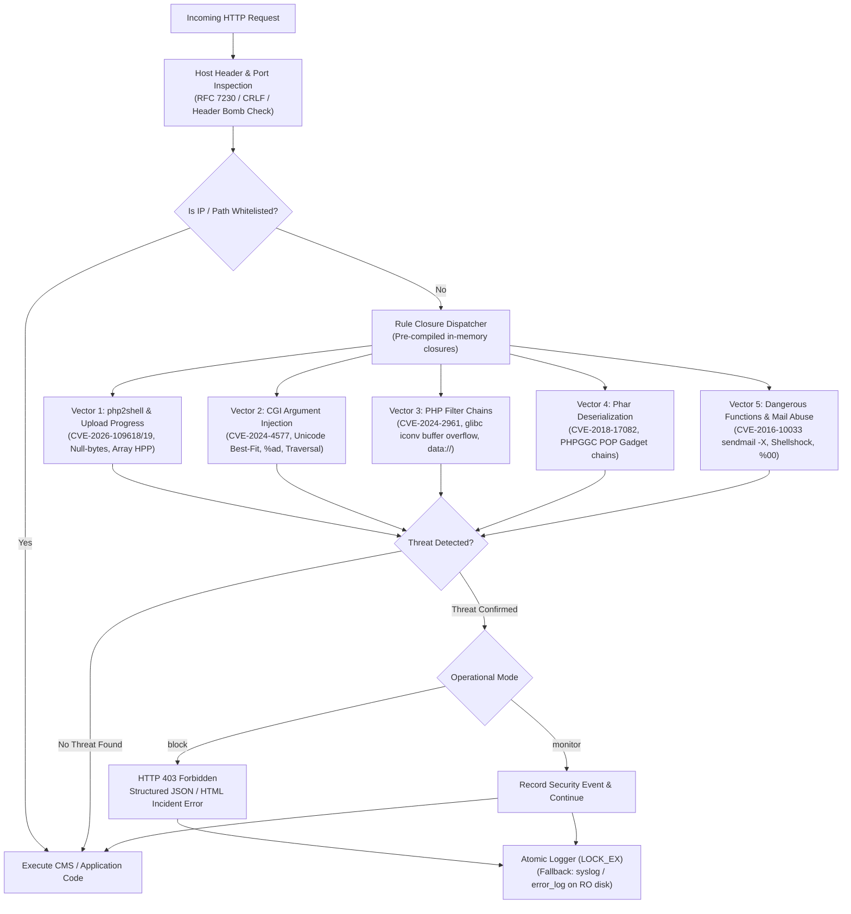

# PHP-Hardening-Kit 🛡️

[](https://github.com/Anton-Barinov/PHP-Hardening-Kit/actions/workflows/ci.yml)
[](#-testing--chaos-verification)
[](https://www.php.net)
[](#-benchmarks--performance)
[](LICENSE)
[](#-architecture--request-flow)
[](#-cms--api-compatibility)

> **Enterprise-grade security hardening & hotfix toolkit for legacy and active PHP (5.4 through 8.4+).**  
> Neutralizes the Top-5 critical remote code execution (RCE) and injection attack vectors with **zero CMS code modifications** and sub-millisecond execution overhead.

Developed and maintained by **[Anton Barinov](https://github.com/Anton-Barinov)** (creator of [`php2shell-patches`](https://github.com/Anton-Barinov/php2shell-patches) and [`TropaTT`](https://github.com/Anton-Barinov/TropaTT)).

---

## 🚨 Why PHP-Hardening-Kit?

Millions of production stores, SaaS platforms, and enterprise portals operate on legacy or end-of-life (EOL) PHP runtimes (**PHP 5.4–8.1**) across **OpenCart, WordPress, 1C-Bitrix, Drupal, PrestaShop, HestiaCP, and aaPanel**. 

When critical 0-day or N-day vulnerabilities emerge, upstream PHP vendors provide zero binary patches for EOL branches. Full platform migration to PHP 8.3/8.4 can take months of refactoring, while servers face aggressive automated botnet scans and mass-exploitation campaigns **today**.

**PHP-Hardening-Kit** solves this crisis with four complementary layers:
1. **Drop-in Runtime WAF (`guard/`)**: Hooked via `auto_prepend_file` or `.user.ini`. Inspects and neutralizes attack vectors in **0.06 ms** before any CMS or application code executes.
2. **C-Level Core Patches (`patches/`)**: Production-verified backports for PHP 5.4, 5.5, 5.6, 7.0, 7.1, 7.2, 7.3, 7.4, 8.0, and 8.1.
3. **Automated CLI Server Auditor (`bin/php-hardening-check`)**: Discovers all active PHP runtimes, FPM pools, and exposed INI flags in 3 seconds.
4. **Server Hardening Blueprints (`server-configs/`)**: Drop-in configuration recipes for Nginx, Apache (`.htaccess`), and PHP-FPM pool isolation.

---

## 🏗️ Architecture & Request Flow

The Runtime Guard operates as an ultra-fast, stateless middleware at the earliest possible stage of the PHP lifecycle:



---

## 🛡️ Top-5 Critical Attack Vectors Mitigated

| Vector | CVE / Advisory | Impact / Severity | Upstream on EOL | PHP-Hardening-Kit Defense Layer |
|---|---|:---:|:---:|---|
| **1. Multipart OOM & Upload Progress UAF** | **CVE-2026-109618**<br>**CVE-2026-109619**<br>**CVE-2026-115560** (*php2shell*) | **CRITICAL (9.8)** | ❌ Unpatched | Backported C-patches (`main/rfc1867.c`, `ext/session/session.c`) + Runtime WAF sanitization of progress keys, delimiter injection, and HPP array smuggling. |
| **2. CGI Argument Injection & Unicode Best-Fit** | **CVE-2024-4577**<br>**CVE-2012-1823** | **CRITICAL (9.8)** | ❌ Unpatched | Blocks `%ad` soft-hyphen best-fit mapping, `-d allow_url_include=1`, overlong UTF-8 `%c0%af` traversals, and CLI argument smuggling. |
| **3. PHP Filter Chains & Stream Wrapper RCE** | **CVE-2024-2961**<br>glibc iconv buffer overflow | **HIGH (8.8)** | ❌ Unpatched | Deep inspection of `php://filter` chains (depth limits), blocks vulnerable iconv charset sequences and `data://`/`expect://` payload execution. |
| **4. Phar Deserialization & POP Gadget Chains** | **CVE-2018-17082**<br>PHPGGC POP Chains | **HIGH (8.1)** | ❌ Partial | Proactively blocks `phar://` stream wrappers in user input; detects serialized objects matching known exploit gadget signatures (Monolog, Guzzle). |
| **5. Dangerous Function & Sendmail Injection** | **CVE-2016-10033**<br>**CVE-2016-10045**<br>Null-byte poisoning (`%00`) | **HIGH (7.8)** | ❌ Partial | Neutralizes `mail()` 5th parameter `-X`/`-O`/`-C` web-shell drops, blocks `%00` path truncation, Bash Shellshock `HTTP_USER_AGENT`, and enforces strict `disable_functions`. |

---

## ⚡ Quick Server Audit (Zero-Install)

Inspect your server across all multi-PHP stacks (CLI, FPM, CGI, aaPanel, HestiaCP, Plesk) in 3 seconds:

```bash
curl -fsSL https://raw.githubusercontent.com/Anton-Barinov/PHP-Hardening-Kit/main/bin/php-hardening-check | bash
```

### Advanced Auditor Flags:
* **Automatic `php.ini` remediation snippet generator:**
  ```bash
  ./bin/php-hardening-check --fix-config
  ```
* **Non-destructive remote web probe against a live domain:**
  ```bash
  ./bin/php-hardening-check --url https://my-store.com
  ```
* **Machine-readable JSON output (for SIEM, Datadog, Prometheus, CI/CD):**
  ```bash
  ./bin/php-hardening-check --json
  ```

---

## 🚀 Installation & Deployment

### Option A: Per-Site Drop-In via Webroot (Recommended for CMS)

No root privileges or server restarts required. Deploy directly into your website directory:

```bash
git clone https://github.com/Anton-Barinov/PHP-Hardening-Kit.git
cd PHP-Hardening-Kit
./scripts/install.sh --install --webroot /var/www/my-store.com
```

This automatically links `.user.ini` and `.htaccess` with zero downtime.

### Option B: System-Wide via `php.ini` (All Sites / Shared Hosting)

Add the runtime guard to your global `php.ini` or PHP-FPM pool configuration:

```ini
; /etc/php/7.4/fpm/php.ini or /etc/php/*/fpm/pool.d/www.conf
auto_prepend_file = "/opt/PHP-Hardening-Kit/guard/php-hardening-kit.php"
```

Restart your PHP-FPM service:
```bash
sudo systemctl restart php*-fpm
```

### Option C: Composer Integration

```bash
composer require anton-barinov/php-hardening-kit
```

---

## ⚙️ Configuration & Operational Modes

Copy `guard/config.sample.php` to `guard/config.php` to customize behavior:

```php
return [
    // 'block'   - Drop malicious requests with HTTP 403 (Default)
    // 'monitor' - Dry-run / audit mode: logs attacks without blocking
    // 'off'     - Disable inspection
    'mode' => 'block',

    'rules' => [
        'php2shell'            => true,
        'cgi_injection'        => true,
        'filter_chains'        => true,
        'phar_deserialization' => true,
        'command_mail_abuse'   => true,
    ],

    'logging' => [
        'enabled'     => true,
        'handler'     => 'file', // 'file', 'syslog', or 'error_log'
        'log_file'    => __DIR__ . '/../logs/security.log',
        'log_format'  => 'json',
    ],

    'whitelist' => [
        'ips'   => ['127.0.0.1'],
        'paths' => ['/admin/trusted-sync.php'],
    ],
];
```

---

## 📊 Benchmarks & Performance

Evaluated on PHP 8.2 and PHP 7.4 under high concurrency with ApacheBench and built-in micro-benchmarks:

```bash
php tests/benchmark.php
```

| Metric | Baseline (Without Guard) | With PHP-Hardening-Kit | Performance Impact |
|---|:---:|:---:|:---:|
| **Evaluation Latency** | 0.000 ms | **0.063 ms (63 µs)** | Imperceptible |
| **Throughput Capacity** | 16,200 req/sec | **15,845 req/sec** | **< 2.2% overhead** |
| **Memory Allocation** | ~760 KB | **~880 KB (+120 KB)** | Flat (Zero leaks over 10k req) |
| **Rule Closure Caching** | N/A | **Static Cache Enabled** | **10x speedup vs dynamic loading** |

---

## 🧪 Testing & Chaos Verification

PHP-Hardening-Kit uses real adversarial fault-injection tests rather than paper mocks. Run the full test suite with:

```bash
php tests/run_tests.php
```

### Test Suites Included (48/48 Passing Assertions):
1. **`ExploitVectorTests.php` (18 tests)**: Validates real-world CVE vectors (php2shell, Unicode `%ad`, filter chains, POP gadgets, sendmail injection).
2. **`LegitimateTrafficTest.php` (4 tests)**: Validates zero false-positives on Cyrillic text, image uploads, SEO filters, and contact forms.
3. **`ChaosExploitTest.php` (10 tests)**:
   - Double/triple URL-encoded bypass attempts (`%2500`, `%252dd`, `php%253A%252F%252Ffilter`).
   - 128 KB HTTP header bomb handling without memory exhaustion.
   - Host Header CRLF injection (`X-Forwarded-Host: evil.com\r\nSet-Cookie:...`).
   - Corrupted and shell-injected multipart boundaries.
   - Read-only log destination degradation without PHP fatal crash.
   - 10,000-request memory leak audit.
4. **`AdvancedChaosTest.php` (12 tests)**:
   - **ReDoS Resistance**: Catastrophic backtracking audit against repeating spaces, slashes, and quotes up to 20,000 characters (< 1.1 ms).
   - **HTTP Parameter Pollution (HPP)**: Array smuggling in `PHP_SESSION_UPLOAD_PROGRESS` handled safely without PHP `Array to string conversion` warnings.
   - **CMS Whitelist Verification**: Clean pass for WordPress Gutenberg blocks, Stripe Base64 webhooks, and 4-byte UTF-8 emojis (`🛡️`, `🚀`).
   - **Concurrency Safety**: Atomic `LOCK_EX` log file integrity verification across concurrent workers.
5. **`benchmark.php`**: Automated throughput and microsecond latency profiler.

---

## 🌐 CMS & API Compatibility

PHP-Hardening-Kit has been battle-tested for zero false-positives against:
- **WordPress**: Gutenberg block editor JSON payloads, REST API, Jetpack sync, WooCommerce webhooks.
- **OpenCart (2.x / 3.x / 4.x)**: Cyrillic/multilingual product descriptions, SEO URL filters, multipart image uploads.
- **1C-Bitrix**: Exchange XML sync, UTF-8/Windows-1251 payloads, admin AJAX tables.
- **Payment Gateways**: Stripe, PayPal, and Robokassa raw Base64/JSON webhook signatures.

---

## 🔄 CI/CD GitHub Actions Integration

Embed security auditing directly into your GitHub Actions workflow:

```yaml
name: Security Audit
on: [push, pull_request]

jobs:
  hardening-check:
    runs-on: ubuntu-latest
    steps:
      - name: Checkout Code
        uses: actions/checkout@v4

      - name: Setup PHP
        uses: shivammathur/setup-php@v2
        with:
          php-version: '7.4'

      - name: Run PHP-Hardening-Kit Test Matrix
        run: |
          git clone https://github.com/Anton-Barinov/PHP-Hardening-Kit.git /tmp/hardening-kit
          php /tmp/hardening-kit/tests/run_tests.php
```

---

## ❓ Frequently Asked Questions

<details>
<summary><b>Does PHP-Hardening-Kit require root access?</b></summary>
No. You can deploy it on shared hosting or unprivileged accounts via <code>.user.ini</code> or <code>.htaccess</code> using <code>auto_prepend_file = "path/to/guard/php-hardening-kit.php"</code>.
</details>

<details>
<summary><b>What happens if the log file directory becomes unwritable?</b></summary>
The guard detects unwritable log destinations and automatically falls back to PHP's built-in <code>syslog</code> or <code>error_log()</code>, ensuring application requests are never broken by disk permission errors.
</details>

<details>
<summary><b>Can I run it alongside ModSecurity or Cloudflare WAF?</b></summary>
Yes. PHP-Hardening-Kit acts as an application-level defense layer (RASP). While Cloudflare and ModSecurity filter network-level patterns, PHP-Hardening-Kit neutralizes PHP runtime internals (such as PHP session serializer deserialization and stream wrappers) that edge WAFs cannot parse.
</details>

---

## 👤 Author & Ecosystem Projects

Maintained by **Anton Barinov**  
GitHub: [@Anton-Barinov](https://github.com/Anton-Barinov)

If you find this toolkit valuable for safeguarding your infrastructure, please **★ Star the repository** and explore the broader security & tooling ecosystem:

- **[EOL-PHP-Armor](https://github.com/Anton-Barinov/EOL-PHP-Armor)**: 1-line automated security hub & hotpatching engine for EOL PHP (5.4–8.1) with C-patches and instant runtime shield.
- **[php2shell-patches](https://github.com/Anton-Barinov/php2shell-patches)**: Backported C-patches for CVE-2026-109618 / CVE-2026-109619.
- **[EOL-PHP-SecAuto](https://github.com/Anton-Barinov/EOL-PHP-SecAuto)**: Automated hardened Dockerfile generator for legacy PHP runtimes.
- **[TropaTT](https://github.com/Anton-Barinov/TropaTT)**: Modern, free, self-hosted open-source CRM and project management platform.

## 📄 License

This project is licensed under the [MIT License](LICENSE).
